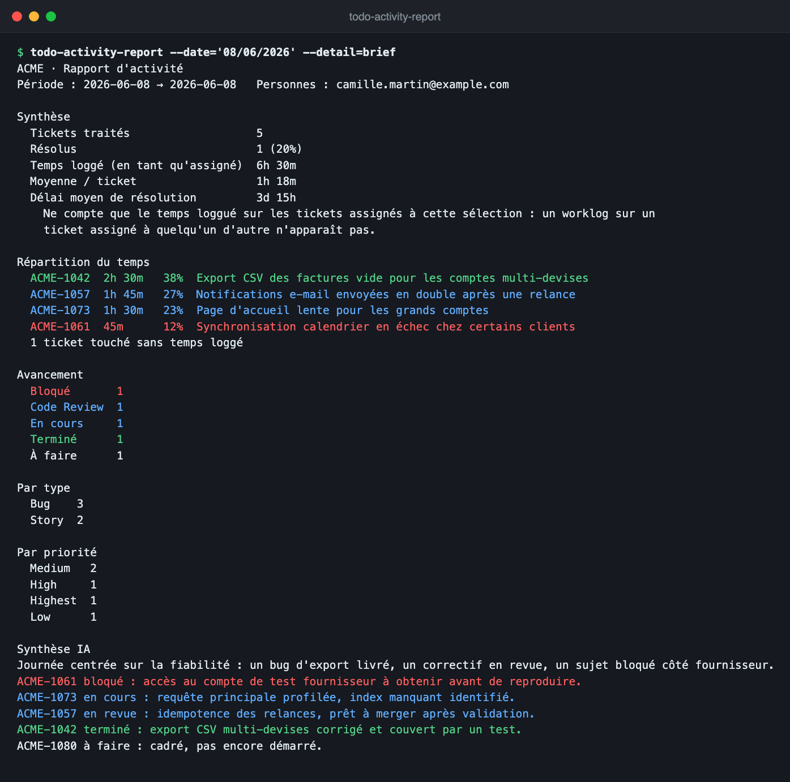

# todo-activity-report

**Qu'est-ce que j'ai fait hier, et combien de temps sur quoi ?** Une commande,
une réponse : le rapport d'activité d'une personne sur un board de tickets, lu
directement depuis le tracker (Jira fourni).


<sub>Board et tickets fictifs. Sortie réelle du CLI.</sub>

- **Zéro saisie** : sans aucun flag, la personne configurée au dernier jour ouvré
  (le lundi remonte au vendredi).
- **Tout ce qui a été travaillé**, pas seulement les tickets résolus : temps
  loggué **ou** changement de statut ce jour-là (`--touched` élargit à tout
  commentaire ou édition).
- **Répartition du temps** par ticket, avancement par statut, cause racine et
  correctif, délai de résolution.
- **Lecture en un coup d'œil** : rouge = bloqué, bleu = en cours, vert = livré,
  les bloquants d'abord.
- **Synthèse IA** prête à lire au daily, via le CLI `claude` local (aucune clé)
  ou l'API Anthropic. Facultative : `--no-ai`.
- **Un seul binaire** : Go pur, aucune dépendance, macOS et Linux. Français par
  défaut, anglais avec `APP_LOCALE=en`.

## Installation

### Binaire (recommandé)

Prérequis : un accès au dépôt (il est **privé**, demander l'accès à son
propriétaire) et la CLI [`gh`](https://cli.github.com) connectée (`gh auth login`).

```bash
TAG=v1.2.0
TARGET=darwin-arm64     # darwin-amd64 (Mac Intel), linux-amd64, linux-arm64

gh release download "$TAG" --repo LucasLaurens/todo-activity-report \
  --pattern "todo-activity-report-$TARGET" --pattern SHA256SUMS
shasum -a 256 -c SHA256SUMS --ignore-missing      # Linux : sha256sum -c …
mkdir -p ~/bin
install -m 755 "todo-activity-report-$TARGET" ~/bin/todo-activity-report
```


`~/bin` doit être dans le `PATH`. Sur macOS, si Gatekeeper bloque le premier
lancement : `xattr -d com.apple.quarantine ~/bin/todo-activity-report`.
Détails, mise à jour et désinstallation : [docs/install.md](docs/install.md).

### Depuis les sources

Go 1.22 ou plus (il télécharge seul le toolchain patché épinglé dans `go.mod`) :

```bash
git clone https://github.com/LucasLaurens/todo-activity-report.git
cd todo-activity-report
go build -o todo-activity-report ./cmd/todo-activity-report
```

## Configuration

Le CLI lit un fichier `.env`, cherché dans le répertoire courant **puis** à côté
du binaire : aucun `export` nécessaire. Pour une installation binaire, le placer
dans `~/bin/.env` :

```bash
cat > ~/bin/.env <<'ENV'
TRACKER_PROJECT=ACME
JIRA_BASE_URL=https://your-org.atlassian.net
JIRA_EMAIL=john.doe@example.com
JIRA_API_TOKEN=colle-ton-token-ici
ENV
chmod 600 ~/bin/.env
```

| Variable | Valeur |
|----------|--------|
| `TRACKER_PROJECT` | la clé du board, celle des tickets (`ACME-1042` → `ACME`) |
| `JIRA_BASE_URL` | l'URL du site Atlassian, en **HTTPS** |
| `JIRA_EMAIL` | l'adresse du compte Atlassian |
| `JIRA_API_TOKEN` | https://id.atlassian.com/manage-profile/security/api-tokens → *Create API token* |

Depuis les sources, partir du modèle commenté : `cp .env.example .env`. Toutes
les variables (personne par défaut, champs de cause racine, langue, modèle IA)
sont décrites plus bas, dans [Tokens et secrets](#tokens-et-secrets).

## Utilisation

```bash
# Ce que j'ai fait au dernier jour ouvré
todo-activity-report

# Hier, en brief oral : chiffres + synthèse IA
todo-activity-report --date='hier' --detail=brief

# Un jour précis, pour quelqu'un d'autre
todo-activity-report --date='08/06/2026' --user='john.doe@example.com'

# Tout le board sur un jour
todo-activity-report --date='08/06/2026' --all

# Une plage, plusieurs personnes, toutes les lignes
todo-activity-report --from='01/05/2026' --to='31/05/2026' \
  --user='John Doe' --user='Jane Smith' --limit=0

# En anglais, sans résumé IA
APP_LOCALE=en todo-activity-report --date='08/06/2026' --no-ai
```

Le mode `--detail=brief` ne garde que les chiffres et la synthèse, pour le daily :



Le tracker est un **adapter interchangeable** : Jira est fourni, brancher un
autre outil ne touche ni le domaine ni le use case — voir
[docs/trackers.md](docs/trackers.md). Architecture hexagonale, stdlib
uniquement, zéro dépendance tierce.

## Flags

| Flag | Description |
|------|-------------|
| `--date` | un jour `JJ/MM/AAAA` (exclusif avec `--from`/`--to`) |
| `--from` / `--to` | plage `JJ/MM/AAAA` (fin incluse) |
| `--user` | nom, email ou identifiant — répétable / séparé par virgules (vide = tous) |
| `--project` | clé du projet / board (défaut : `TRACKER_PROJECT` du `.env`) |
| `--all` | tout le board au lieu d'une personne (exclusif avec `--user`) |
| `--touched` | inclut aussi les tickets simplement mis à jour (commentaire, édition de champ) |
| `--limit` | nb max de tickets détaillés (défaut 20 ; `0` = tous) |
| `--detail` | `brief` (chiffres + synthèse IA), `normal` (défaut), `full` (textes non tronqués) |
| `--no-ai` | désactive le résumé IA |
| `--no-resolve` | passe les `--user` bruts au tracker (sans résolution d'identifiant) |
| `--version` | version du binaire (tag gravé au build, `dev` en local) |
| `--help` | aide complète |

Tracker choisi par `TRACKER` (`jira` par défaut) et board par `TRACKER_PROJECT`.
Avec l'adapter Jira, `JIRA_BASE_URL`, `JIRA_EMAIL` et `JIRA_API_TOKEN` sont
requis — voir [docs/jira-setup.md](docs/jira-setup.md). Langue via `APP_LOCALE`
(`fr` défaut, `en`).

## Tokens et secrets

Tout part de `.env`, copié depuis [`.env.example`](.env.example) :

```bash
cp .env.example .env
```

`.env` est ignoré par git. Aucun `export` n'est nécessaire : le binaire le
charge seul, depuis le répertoire courant **puis** depuis son propre dossier.

### Requis par le CLI

| Variable | Où l'obtenir |
|----------|--------------|
| `TRACKER` | nom de l'adapter, `jira` par défaut. Ce n'est pas un secret |
| `TRACKER_PROJECT` | la clé du board, telle qu'elle apparaît dans les clés de ticket (`ACME-1042` → `ACME`) |
| `TRACKER_USER` | la personne ciblée sans `--user` (défaut : le compte du tracker) |
| `JIRA_BASE_URL` | l'URL de ton site Atlassian, sans chemin — `https://your-org.atlassian.net`. **HTTPS obligatoire**, le CLI refuse le HTTP |
| `JIRA_EMAIL` | l'adresse du compte Atlassian, celle qui a généré le token |
| `JIRA_API_TOKEN` | https://id.atlassian.com/manage-profile/security/api-tokens → *Create API token* → copie la valeur, elle n'est affichée qu'**une seule fois** |

Le token porte tes propres droits : il voit ce que tu vois, rien de plus. Détail
des permissions et des champs custom dans [docs/jira-setup.md](docs/jira-setup.md).
Un autre tracker apporte ses propres variables — voir [docs/trackers.md](docs/trackers.md).

### Optionnels

| Variable | Où l'obtenir | Quand la remplir |
|----------|--------------|------------------|
| `ANTHROPIC_API_KEY` | https://console.anthropic.com → *API keys* → *Create key* | Uniquement si le CLI `claude` n'est pas installé. Sinon **laisse vide** : le CLI local réutilise ta session, sans clé |
| `ANTHROPIC_MODEL` | — | Pour forcer un modèle. Ce n'est pas un secret |
| `JIRA_ROOT_CAUSE_FIELD` | Jira → *Paramètres* → *Tickets* → *Champs personnalisés*, relève l'id `customfield_XXXXX` | Champ portant la note de cause racine. Ce n'est pas un secret, juste un identifiant |
| `JIRA_CORRECTION_FIELD` | idem | Seulement si un champ distinct porte le correctif. Vide, la Correction est extraite du même champ que la Cause |
| `APP_LOCALE` | — | `fr` (défaut) ou `en`. Ce n'est pas un secret |

### Autour du dépôt, pas dans `.env`

Le dépôt est privé, donc cloner et télécharger une Release demandent une
authentification GitHub. Elle est déléguée à `gh` (`gh auth login`), qui garde le
jeton dans le trousseau du système : **aucun token à écrire dans un fichier**, et
le CLI n'en lit jamais. Le `git push` en SSH n'en a pas besoin non plus.

### Sentry

Le projet n'utilise pas Sentry. Aucune variable `SENTRY_*` n'est lue nulle part
dans le code — ne pas en ajouter à `.env` : elle serait morte.

### Hygiène

- `.env` ne doit jamais être commité ni affiché. Pour le lire dans un script,
  le sourcer dans un sous-shell (`set -a; . .env; set +a`), jamais `cat`.
- La CI n'a besoin d'aucun secret : elle compile, teste et publie avec le
  `GITHUB_TOKEN` fourni par la plateforme.
- Un token exposé se révoque, il ne se répare pas : supprime-le côté émetteur
  (Atlassian, Anthropic, GitHub) puis régénère-en un neuf.
- Le résumé IA envoie les titres, causes et commentaires des tickets à Claude —
  voir [confidentialité](docs/configuration.md#confidentialité-du-résumé-ia).

## Documentation

| Doc | Contenu |
|-----|---------|
| [docs/install.md](docs/install.md) | **installer** : binaire seul (Release) ou sources, empreintes, cross-compile |
| [docs/usage.md](docs/usage.md) | flags, **exemples**, format de sortie, couleurs, métriques |
| [docs/configuration.md](docs/configuration.md) | variables d'env, langue (i18n), secrets, pont env → app |
| [docs/jira-setup.md](docs/jira-setup.md) | "creds" Jira, token, accountId, champs custom |
| [docs/trackers.md](docs/trackers.md) | **brancher un autre tracker** : le port `Tracker`, l'adapter, le registre |
| [docs/architecture.md](docs/architecture.md) | couches hexagonales, flux d'exécution, DIP |
| [docs/conventions.md](docs/conventions.md) | SOLID, patterns, perf, sécurité — où chaque règle s'applique |
| [docs/testing.md](docs/testing.md) | stratégie de test (AAA, pas de mocks, `t.Parallel`) |
| [docs/ci.md](docs/ci.md) | pipeline GitHub Actions (quality en parallèle, build / release sur tag) |
| [docs/status.md](docs/status.md) | **état courant** (livré / limites / dépendances) |

Conventions normatives : [docs/conventions.md](docs/conventions.md).

## Structure

```
cmd/todo-activity-report          point d'entrée, flags, câblage
internal/domain              entités + value objects (Task, TimeSpent, Optional, Metrics)
internal/application         ReportService + MetricsCalculator + PassthroughResolver
internal/application/ports   interfaces Tracker, TaskProvider, UserResolver, Summarizer, ProgressReporter
internal/architecture        test de frontières hexagonales (aucun code de prod)
internal/i18n                traductions (fr/en, fr par défaut)
internal/infrastructure/jira adapter Jira — une implémentation de ports.Tracker
internal/infrastructure/llm  adapters IA (CLI claude, API Anthropic, no-op)
internal/infrastructure/cli  rendu terminal (couleurs par statut) + loader
internal/config              env → config typée → registre des trackers + fabriques
internal/testsupport         fakes in-memory (tests)
scripts/                     export quotidien du brief dans l'app Notes (macOS)
docs/                        documentation détaillée
docs/images/                 captures d'écran utilisées par la doc
```
