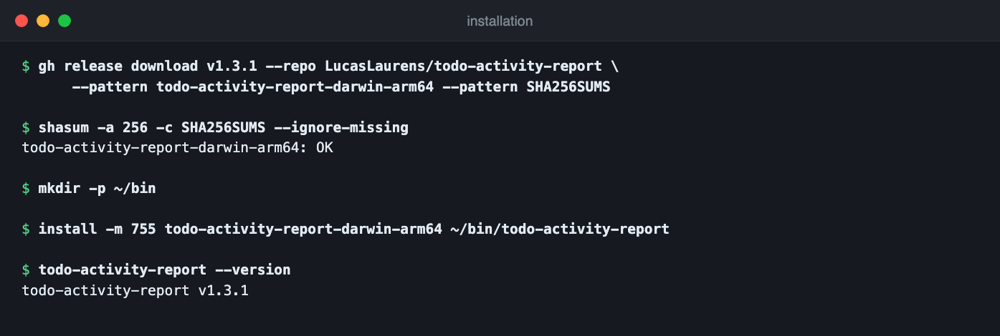

# Installation

[← Retour au README](../README.md)

Deux façons d'installer : **le binaire seul** (rien d'autre à télécharger) ou
**depuis les sources**.

---

## 1. Binaire seul (sans cloner le dépôt)

Le binaire est **autonome** : pur Go, stdlib uniquement, aucune dépendance
tierce, statiquement lié (aucune libc requise) et les traductions `fr`/`en` sont
**embarquées** dedans (`go:embed`). Il ne lit **aucun fichier du dépôt** à
l'exécution.

Il ne réclame que deux choses :

1. un board (`TRACKER_PROJECT`) et les identifiants de l'adapter choisi —
   par défaut Jira : `JIRA_BASE_URL`, `JIRA_EMAIL`, `JIRA_API_TOKEN`, voir
   [jira-setup.md](jira-setup.md) ;
2. rien d'autre. Le résumé IA est optionnel : CLI `claude` local s'il est
   présent, sinon `ANTHROPIC_API_KEY`, sinon la section est simplement omise.

### Cibles publiées

| Fichier | Plateforme |
|---------|------------|
| `todo-activity-report-darwin-arm64` | macOS Apple Silicon (M1→M4) |
| `todo-activity-report-darwin-amd64` | macOS Intel |
| `todo-activity-report-linux-amd64` | Linux x86-64 |
| `todo-activity-report-linux-arm64` | Linux ARM64 |
| `SHA256SUMS` | empreintes des 4 binaires |

Chaque tag pousse ces fichiers dans une **Release GitHub** (voir [ci.md](ci.md#build--release-sur-tag)).
Dernière release : **v1.3.1** — liste complète via
`gh release list --repo LucasLaurens/todo-activity-report`.

### Télécharger et installer

Le dépôt est **privé** : le téléchargement demande une authentification GitHub.
Le plus simple est `gh`, qui réutilise la session existante — inutile de
manipuler un token à la main :

```bash
TAG=v1.3.1                    # tag visé
TARGET=darwin-arm64           # ou darwin-amd64, linux-amd64, linux-arm64

# 1. binaire + empreintes, sous leur nom de publication
gh release download "$TAG" --repo LucasLaurens/todo-activity-report \
  --pattern "todo-activity-report-$TARGET" --pattern SHA256SUMS

# 2. vérifier AVANT de renommer (voir plus bas)
shasum -a 256 -c SHA256SUMS --ignore-missing   # macOS
sha256sum -c SHA256SUMS --ignore-missing       # Linux

# 3. installer (~/bin doit être dans le PATH)
mkdir -p ~/bin
install -m 755 "todo-activity-report-$TARGET" ~/bin/todo-activity-report

# 4. identifiants, à côté du binaire (auto-chargés, aucun export nécessaire)
printf 'TRACKER_PROJECT=ACME\nJIRA_BASE_URL=https://your-org.atlassian.net\nJIRA_EMAIL=…\nJIRA_API_TOKEN=…\n' > ~/bin/.env
chmod 600 ~/bin/.env

# 5. utiliser
~/bin/todo-activity-report --date="$(date +%d/%m/%Y)" --user='john.doe@example.com'
```

Installation minimale = **2 fichiers** : le binaire (~6 Mo) et le `.env`.

Depuis un navigateur, la page des Releases fait la même chose en un clic — la
session GitHub suffit.

> Sur un dépôt privé, l'URL directe
> `https://github.com/<org>/<dépôt>/releases/download/<tag>/<nom>` répond **404**
> sans authentification. C'est une vraie erreur : `curl -f` s'arrête et
> n'écrit rien. Le risque n'est donc pas un faux fichier, c'est une commande qui
> ne marche pas — d'où `gh release download`, qui porte la session.

### Vérifier l'empreinte (recommandé)

`SHA256SUMS` référence les fichiers sous leur **nom de publication**
(`todo-activity-report-darwin-arm64`). La vérification doit donc précéder le
renommage — c'est pourquoi l'étape 3 ci-dessus installe *après* l'étape 2 :

```bash
$ shasum -a 256 -c SHA256SUMS --ignore-missing
todo-activity-report-darwin-arm64: OK
```

Renommer d'abord le binaire en `todo-activity-report` fait échouer la
vérification sans qu'aucune empreinte soit comparée :

```bash
$ shasum -a 256 -c SHA256SUMS --ignore-missing
shasum: SHA256SUMS: no file was verified          # exit 1
```

### Savoir quelle version on a

```bash
todo-activity-report --version     # → todo-activity-report v1.3.1
```

Le tag est injecté à la compilation par le job `release`
(`-ldflags="-X main.version=$GITHUB_REF_NAME"`). Un binaire compilé à la main sans
ce flag répond `dev`.

### macOS : lever la quarantaine

Un binaire téléchargé hors App Store est marqué par Gatekeeper. Si le premier
lancement affiche « ne peut pas être ouvert car son développeur ne peut pas être
vérifié » :

```bash
xattr -d com.apple.quarantine ~/bin/todo-activity-report
```

### Où placer le `.env`

`internal/config/dotenv.go` cherche `.env` **dans le répertoire courant, puis à
côté de l'exécutable**, et applique les deux (première clé gagnante). Donc :

- `.env` à côté du binaire → marche depuis n'importe quel dossier ;
- `.env` dans le dossier courant → surcharge ponctuelle (autre instance, autre tracker) ;
- variables déjà exportées dans l'environnement → priorité sur les deux fichiers.

Détail complet : [configuration.md](configuration.md).

> ⚠️ Le `.env` porte le token du tracker (et éventuellement la clé Anthropic). Il reste
> **local à chaque poste**, en `chmod 600`, jamais dans un artifact CI ni à côté
> d'un binaire partagé.

---

## 2. Depuis les sources

```bash
git clone https://github.com/LucasLaurens/todo-activity-report.git && cd todo-activity-report
cp .env.example .env          # puis renseigner le tracker et ses identifiants
go build -o todo-activity-report ./cmd/todo-activity-report
./todo-activity-report --date='08/06/2026'
```

### Compiler pour une autre plateforme

Pur Go, aucun cgo → la compilation croisée ne demande **aucun toolchain C** :

```bash
GOOS=linux GOARCH=amd64 go build -trimpath -ldflags="-s -w" \
  -o todo-activity-report-linux-amd64 ./cmd/todo-activity-report
```

`-ldflags="-s -w"` retire la table des symboles et le DWARF : ~8,5 Mo → ~6 Mo.
Ajouter `-X main.version=<tag>` pour que `--version` annonce autre chose que `dev`.
`-trimpath` supprime les chemins absolus du binaire (build reproductible).

---

## Mise à jour

Remplacer le binaire, le `.env` reste en place :

```bash
TAG=v1.1.0                    # tag visé
TARGET=darwin-arm64
gh release download "$TAG" --repo LucasLaurens/todo-activity-report \
  --pattern "todo-activity-report-$TARGET" --pattern SHA256SUMS
shasum -a 256 -c SHA256SUMS --ignore-missing
install -m 755 "todo-activity-report-$TARGET" ~/bin/todo-activity-report
~/bin/todo-activity-report --version          # confirme le tag installé
```

## Désinstaller

```bash
rm ~/bin/todo-activity-report ~/bin/.env
```

---

## Captures d'écran

Téléchargement, vérification de l'empreinte et premier lancement de la v1.3.1 :



Reste à fournir : `docs/images/install-release.png` (page Release GitHub avec
les assets), puis décommenter :

<!--  -->
