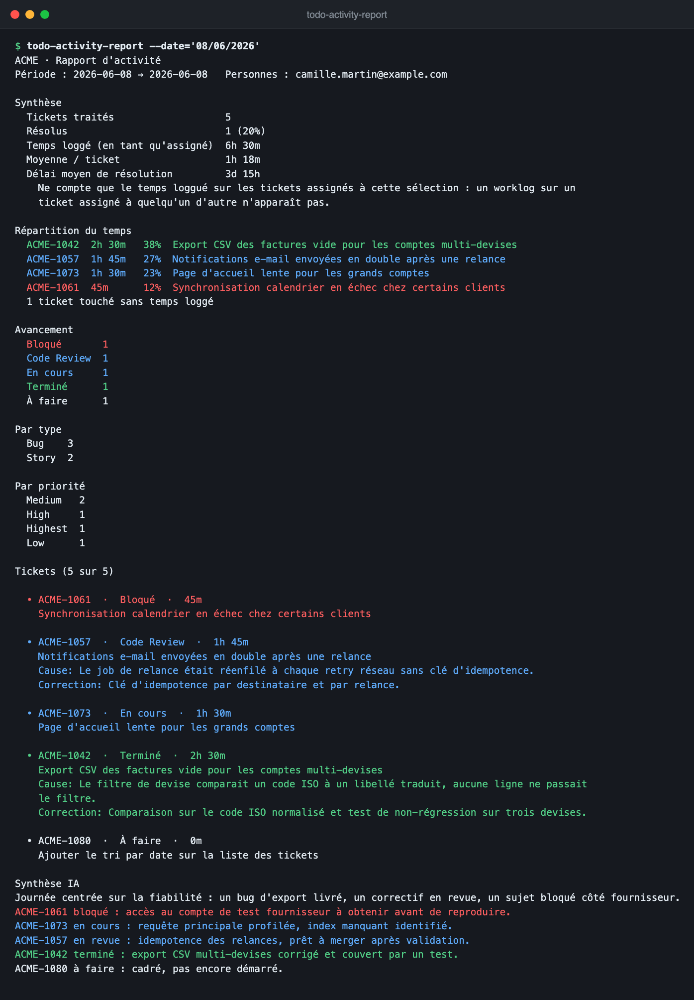

# Utilisation

[← Retour au README](../README.md)

Prérequis : config en place ([configuration.md](configuration.md)).

## Lancer

```bash
go build -o todo-activity-report ./cmd/todo-activity-report

# un seul jour
./todo-activity-report --date='01/06/2026' --user='John Doe'

# une plage de dates, par email
./todo-activity-report --from='01/05/2026' --to='31/05/2026' --user='john.doe@example.com'

# plusieurs utilisateurs (répété ou séparé par virgules)
./todo-activity-report --date='01/06/2026' --user='John Doe' --user='Jane Smith'

# tout le board, sans IA
./todo-activity-report --from='01/05/2026' --to='31/05/2026' --no-ai

# sortie + résumé IA en anglais
APP_LOCALE=en ./todo-activity-report --date='08/06/2026'

# autre projet, toutes les tâches détaillées
./todo-activity-report --project=OTHER --date='01/06/2026' --limit=0
```

## Wrapper shell `activity-report`

Une fonction zsh (dans `~/.zshrc`, hors dépôt) évite de retaper les flags du
quotidien. Sans argument, elle demande la date (défaut : aujourd'hui) puis
l'utilisateur (vide = l'utilisateur par défaut codé dans la fonction, `all` =
tout le board), et appelle le binaire avec `--brief` :

```bash
activity-report
# Date (JJ/MM/AAAA) [28/08/2026] :
# User (nom/email, vide = <défaut>, 'all' = tous) :
```

Dès qu'un argument commençant par `-` est passé, la fonction rend la main au
binaire sans jouer les prompts — l'aide et les invocations explicites restent
directes :

```bash
activity-report --help
activity-report --from='01/05/2026' --to='31/05/2026' --no-ai
```

Le wrapper pointe le binaire compilé à la racine du dépôt : après un changement
de code, relancer `go build -o todo-activity-report ./cmd/todo-activity-report`.

## Flags

| Flag | Défaut | Description |
|------|--------|-------------|
| `--date` | — | un seul jour, `JJ/MM/AAAA` (exclusif avec `--from`/`--to`) |
| `--from` | — | début de plage inclus, `JJ/MM/AAAA` |
| `--to` | — | fin de plage incluse, `JJ/MM/AAAA` |
| `--user` | (vide = tous) | nom, email **ou** identifiant du tracker — répétable / séparé par virgules |
| `--project` | `TRACKER_PROJECT` | clé du projet / board (la **clé**, pas le nom du board) |
| `--no-ai` | `false` | désactive le résumé IA |
| `--version` | — | affiche la version du binaire et sort (aucune config requise) |
| `--no-resolve` | `false` | passe les termes `--user` bruts au tracker, sans résolution d'identifiant |
| `--limit` | `20` | nombre max de tâches listées en détail (`0` = toutes) |
| `--full` | `false` | affiche les textes complets (root cause / fix / résumés non tronqués) |
| `--brief` | `false` | n'affiche que les métriques + la synthèse IA (masque Causes racines et Tickets) |
| `--help` | — | affiche l'aide (usage, options, exemples) puis quitte |

Fournir **soit** `--date`, **soit** `--from` ET `--to`. La fin de plage est
inclusive jusqu'à 23:59 du jour.

### Tâches du jour

```bash
./todo-activity-report --date='08/06/2026' --user='john.doe@example.com'        # les tiennes
./todo-activity-report --date='08/06/2026'                                      # tout le board
```

### Progression (loader)

Quand la sortie est un terminal, un spinner sur **stderr** montre l'étape en
cours (« Résolution des utilisateurs », « Récupération des tâches Jira »,
« Calcul des métriques », « Génération du résumé »), puis disparaît avant le
rapport. En sortie redirigée/pipe : aucun spinner (rapport propre sur stdout).

### `--user` : résolu en accountId

Jira Cloud identifie les utilisateurs par **accountId**. Le CLI accepte un nom
affiché, un email ou un accountId, et résout automatiquement en accountId via
`GET /rest/api/3/user/search` avant d'interroger les tâches.

```bash
--user='john.doe@example.com'                            # email (sans ambiguïté)
--user='John Doe'                                        # nom affiché
--user='712020:00000000-0000-0000-0000-000000000000'    # accountId direct (non résolu)
```

- Un nom collé sans espace (`JohnDoe`) ne correspond à rien → erreur
  `no Jira user matches "JohnDoe"`. Utiliser `John Doe` ou l'email.
- L'accountId se lit aussi dans l'URL d'un board filtré
  (`...?assignee=712020%3A00000000-...`, `%3A` = `:`).
- `--no-resolve` désactive la résolution (le terme brut part dans JQL).

## Sortie

```
ACME — Task Report
Period: 2026-06-08 → 2026-06-08 | Users: john.doe@example.com

Overview
  Total tasks           14
  Resolved              0 (0%)
  Time logged (period)  5h 15m
  Avg / task            22m
  MTTR                  n/a

By status
  Bloqué       11
  Code Review  1
  En cours     1
  Pré-release  1

By type / By priority
  ...
(« Recurring root causes » n'apparaît que si une cause touche ≥2 tickets)

Tasks (14 of 14)

  • ACME-8496  ·  Bloqué  ·  16h 15m
    6 — [GED] Docuthèque
    Cause: <texte complet, wrappé sur la largeur du terminal…>

  • ACME-10399  ·  Pré-release  ·  15h 05m
    BPCE - Catégories de PA …
  ...

AI Summary
  <narratif auto via le CLI claude, ou API si clé>
```

### Couleurs

Les statuts sont colorés quand la sortie va vers un terminal :

| Couleur | Sens | Exemples de statuts |
|---------|------|------------------------|
| 🔴 rouge | bloqué, attente bloquante, **ou blocage signalé en commentaire** | `Bloqué`, `En attente retour client`, + tout ticket dont un commentaire récent signale un blocage |
| 🔵 bleu | travail en vol | `In progress dev`, `Code Review`, `To test`, `Waiting for feat env` |
| 🟢 vert | livré ou état terminal | `Deployed / Completed`, `Waiting for release`, `Fermée` |
| ⚫ défaut | pas encore démarré | `À faire`, `Backlog`, `À spécifier`, `A QUALIFIER` |
| ⚪ gris | abandonné, hors périmètre | `Annulé`, `Obsolète` |

L'ordre des règles compte : les trois statuts « waiting » d'un même board ne veulent pas
dire la même chose. `Waiting for release` est du livrable qui attend le train
(vert), `Waiting for feat env` du travail en vol qui attend son environnement
(bleu), `En attente retour client` une attente bloquante (rouge, avec les autres
attentes). Les règles `release` et `feat env` passent donc **avant** la règle
générique `waiting`/`attente`.

### Blocage signalé en commentaire

Un ticket dont un commentaire récent mentionne un blocage (`bloqué`, `blocked`,
`blocage`, `en attente`, `waiting for`, `stuck`) passe **en rouge même si son
statut dit le contraire**, et sa ligne porte le marqueur
`⚠ blocage signalé en commentaire` (omis quand le statut annonce déjà le
blocage). Les commentaires sont ceux déjà récupérés avec la recherche : aucun
appel réseau en plus. C'est une heuristique par mots-clés — « on n'est plus
bloqué » compte comme un blocage.

La section « Avancement » reste agrégée par statut : elle ne peut pas porter
cette information, qui est propre à un ticket.

### Ordre de lecture : bloquants d'abord

Tickets, lignes de la synthèse IA et section « Avancement » sont ordonnés par
**urgence de lecture**, pas par volume :

1. bloqué (statut ou commentaire)
2. travail en vol
3. livré / terminal
4. pas démarré
5. abandonné

À rang égal : volume décroissant pour « Avancement », clé du ticket pour les
tickets — tri déterministe, donc sortie reproductible. Le prompt IA reçoit les
tickets déjà triés et a pour consigne de **ne pas les réordonner**.

Coloré : la section « Avancement » (ligne entière), **tout le bloc de chaque
ticket** (en-tête, résumé, Cause, Correction) et **chaque ligne de ticket de la
synthèse IA** — celles ouvrant sur une clé `ACME-1234`, colorées d'après le
ticket lui-même (blocage en commentaire inclus), pas d'après leur texte. La
ligne d'ouverture de la synthèse reste neutre : elle parle de tous les statuts à
la fois. Pas de couleur si la sortie est redirigée (pipe, fichier) ou si
`NO_COLOR` est défini — utile pour l'export Notes et les tests.

Capture à ajouter dans [`docs/images/`](images/README.md) (`sortie-couleurs.png`),
puis décommenter :

<!--  -->

## Périmètre : ce qui est « processé » un jour

Un ticket apparaît s'il a, sur la période :

- **du temps loggué** ce jour-là (`worklogDate`), **ou**
- un **changement de statut** ce jour-là (`status CHANGED DURING`), **ou**
- **toute autre mise à jour** ce jour-là — commentaire, édition de champ,
  réassignation — captée par le timestamp `updated`.

Jira n'expose pas de champ `commentedDate` : les commentaires sont donc captés
via `updated`, qui bouge à chaque modification. `status CHANGED` reste dans
l'union car il est historiquement exact (il matche un changement de statut même
quand ce n'est pas la dernière mise à jour du ticket).

Union des trois → on voit tous les tickets réellement touchés, quel que soit
leur état actuel (en cours, bloqué, release, terminé), pas seulement les
terminés. Triés par dernière mise à jour (`updated DESC`).

## Métriques calculées

| Métrique | Définition |
|----------|------------|
| Total tasks | nombre de tickets processés sur la période |
| **By status** | répartition par statut actuel — **l'état d'avancée** (en cours / bloqué / release / terminé…) |
| Resolved | tickets déjà résolus (date de résolution présente) parmi les processés |
| Time logged (period) / Avg | **temps réellement loggué pendant la période** (worklog), pas le cumul du ticket |
| MTTR | temps moyen création → résolution (résolutions antérieures à la création exclues) ; `n/a` si rien de résolu |
| By assignee | volume + résolus + temps loggué par personne |
| By type / priority | distributions |
| Causes racines récurrentes | causes touchant ≥2 tickets (top 5) ; masquée si aucune — les causes uniques restent visibles sous chaque ticket |

### Temps loggué = worklog du jour, par auteur

Pour chaque ticket, le CLI appelle `GET /rest/api/3/issue/{key}/worklog` et somme
les entrées dont la date (`started`) tombe dans la période. Si `--user` est
fourni, **seuls** les worklogs de ces personnes comptent → tu vois le temps que
*cette* personne a passé *ce* jour-là. Un ticket affiché à `0m` est apparu via
un **changement de statut** (sans temps loggué ce jour).

> Coût : un appel worklog par ticket (N+1). Négligeable pour un jour / un user ;
> plus lourd sur de larges plages.

## Automatisation : note quotidienne dans l'app Notes (macOS)

[scripts/activity-notes.sh](../scripts/activity-notes.sh) lance le rapport
`--brief` de la **veille ouvrée** (lundi → vendredi précédent ; sam/dim → rien)
pour la personne visée et le sauvegarde dans Notes (titre
`Résumé d'activité — JJ/MM/AAAA`) **si la note n'existe pas déjà**.

Rien n'est en dur : le script se règle par environnement.

| Variable | Défaut | Rôle |
|----------|--------|------|
| `ACTIVITY_REPORT_USER` | — (**requis**) | valeur passée à `--user` |
| `ACTIVITY_REPORT_BIN` | `$HOME/projects/todo-activity-report/todo-activity-report` | chemin du binaire |
| `ACTIVITY_REPORT_NOTES_FOLDER` | `Résumés d'activité` | dossier Notes cible |

Planifié par `~/Library/LaunchAgents/activity-notes.plist` :
8h30 et 9h00 (le second passage = rattrapage, la déduplication évite le
doublon). Logs : `/tmp/activity-notes.{log,err}`.

```bash
launchctl load ~/Library/LaunchAgents/activity-notes.plist    # activer
launchctl unload ~/Library/LaunchAgents/activity-notes.plist  # désactiver
ACTIVITY_REPORT_USER='john.doe@example.com' /bin/zsh scripts/activity-notes.sh  # test manuel
```

> Premier lancement : macOS demande l'autorisation de contrôler Notes
> (Réglages → Confidentialité → Automatisation) — accepter une fois.
